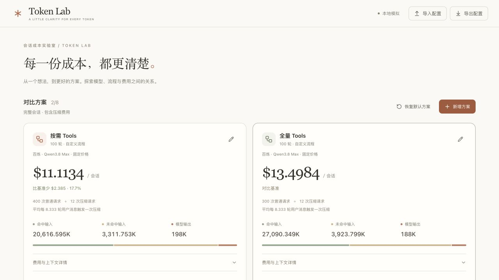

<div align="center">

# Token Lab

**在运行 Agent 之前，看清每一份 Token 成本。**

自定义会话流程 · 多方案成本对比 · 缓存与压缩模拟

Vue 3 · Vite · ECharts · Web Worker

[快速开始](#快速开始) · [核心功能](#核心功能) · [自定义流程](#自定义流程) · [计算与配置文档](docs/simulation.md) · [GitHub](https://github.com/zhangHongEn/token-lab)

</div>



## 为什么做 Token Lab？

一次 Agent 任务，通常包含多次模型调用。系统提示、工具定义、检索结果和历史消息会反复进入上下文；缓存命中率与压缩策略，也会改变最终账单。

Token Lab 是一个**可自定义流程的 Agent 会话成本模拟器**。你可以把会话拆成“追加内容”和“调用模型”两类步骤，为每一步设置预计 Token 用量，再比较不同方案的完整会话费用。

它帮助你回答：

- 工具定义放在初始上下文，还是在需要时查询，费用会差多少？
- 减少一次模型调用，能省下多少输入与输出成本？
- 缓存命中率变化，会怎样影响长会话的累计费用？
- 多久压缩一次上下文、保留几轮历史，更适合当前流程？
- 同一套流程，更换模型费率后的成本差异有多大？

**所有模拟在浏览器本地完成，无需 API Key，也不会调用真实模型。** 输入的是预计 Token 长度，结果用于方案估算；模型质量、实际延迟和真实缓存命中情况需要另行验证。

界面采用简洁数字风与轻量白色卡片。极淡的 Glyph Matrix 在鼠标附近渐变清晰并轻微放大；移动设备与系统减少动态效果设置下保留静态背景。

## 核心功能

| 功能 | 你可以做什么 |
| --- | --- |
| **多方案独立对比** | 同时比较最多 8 个方案，各自配置流程、参数和模型费率；支持新增、复制、删除，并可撤销最近一次配置变更。 |
| **全局模型与会话规模** | 页面顶部统一选择模型并设置用户轮次、Skills / Tools 总数、Prefix 命中率、压缩阈值类型与阈值。全局模型使用内置费率，不提供手动单价输入；各方案默认继承，也可独立设置或恢复继承。导入旧配置时保留原方案数值、模型和费率。 |
| **两阶段流程编辑** | 分别设计初始上下文和每轮执行流程，自由增删、复制、排序、改名或停用步骤，支持撤销步骤删除。 |
| **参数化 Token 用量** | 为步骤选择固定 Token 或 JS 公式，支持变量、条件表达式与 Math 函数，实时预览结果。 |
| **缓存与压缩模拟** | 设置前缀期望命中率；按轮次或 Token 阈值触发压缩，并配置保留轮次与摘要长度。 |
| **费用归因与请求追踪** | 查看每个来源的输入、输出与费用；通过趋势图和请求明细追踪会话变化。 |
| **配置与结果导出** | 用 JSON 保存或分享完整方案，用 CSV 导出请求记录与费用来源。 |

页面提供两套开箱即用的流程：**按需发现工具 Schema** 和 **初始预加载工具 Schema**。两者都是可编辑的普通方案，计算引擎统一按步骤执行，你也可以建立完全不同的流程。

## 快速开始

需要 **Node.js 20.19+ 或 22.12+**。

获取项目源码后，在项目目录运行：

```sh
npm install
npm run dev
```

打开终端显示的本地地址，即可开始对比。

1. **选一个方案**：先使用默认流程，或复制一份作为新的实验方案。
2. **编辑独立草稿**：点击对比卡片上的编辑按钮，在基本参数、执行流程、缓存与压缩、模型与费率四个分区中调整；保存后更新对比，取消不影响原方案。
3. **选择对比基准**：默认自动使用费用最高的方案，也可点击卡片星标手动固定基准，查看总费用、费用差额、来源分布和会话趋势。
4. **保存实验**：导出 JSON 留存配置，或导出 CSV 分析结果。

配置保存在当前页面内存中，刷新页面会恢复默认值；需要保留的方案请先导出 JSON。

## 自定义流程

一次会话由两个阶段组成：

```text
initial：建立初始上下文
    ↓
turn：追加用户消息 → 模型生成计划 → 追加工具结果 → 模型生成回复
    ↓
检查压缩阈值 → 必要时调用模型生成摘要
    ↓
进入下一轮，直到完成设定轮次
```

每个步骤只需描述名称、类型和 Token 长度。更多参数、缓存匹配规则和压缩细节，见 [会话模拟与配置参考](docs/simulation.md)。

## 本地验证与构建

```sh
npm test
npm run build
npm run preview
```

`npm run build` 只生成可部署的静态文件到 `dist/`，不会上传 CDN，也不会访问公司内部服务。GitHub Actions 会在每次提交和 Pull Request 中自动运行测试与构建。

## 参与改进

欢迎讨论新的流程模板、费用展示方式和模拟边界，也欢迎提交修复。

修改计算逻辑后运行 `npm test`，修改界面后再检查 `npm run build`。

